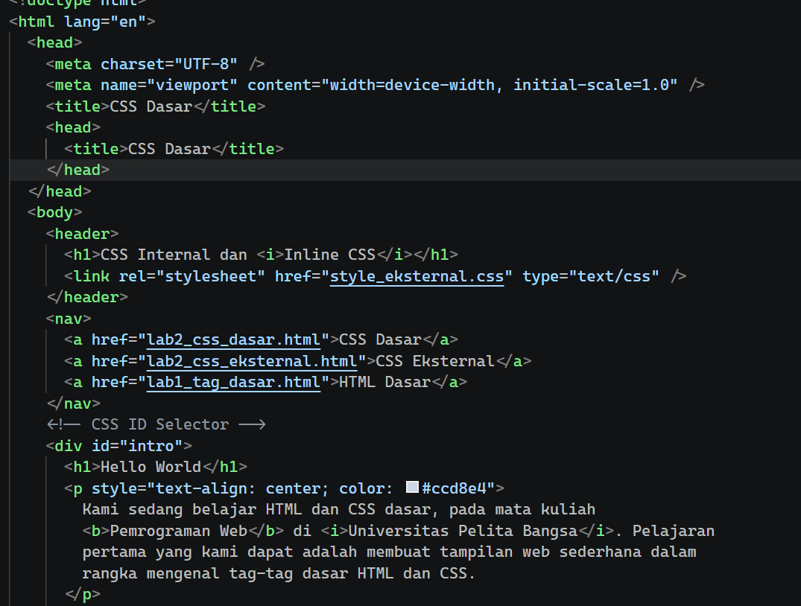
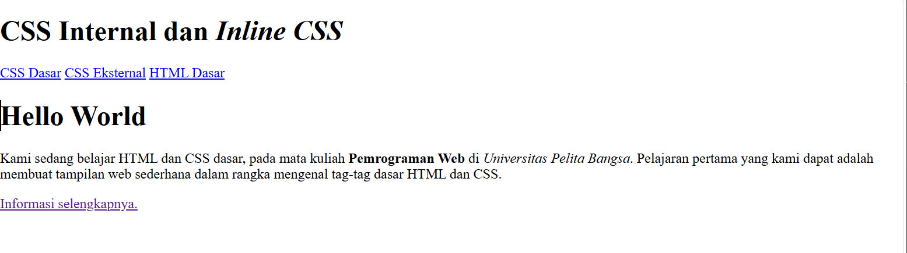
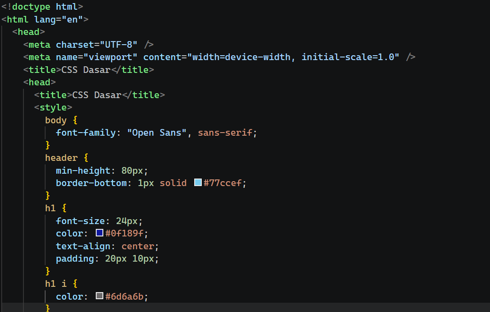
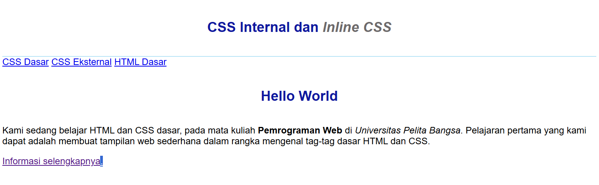
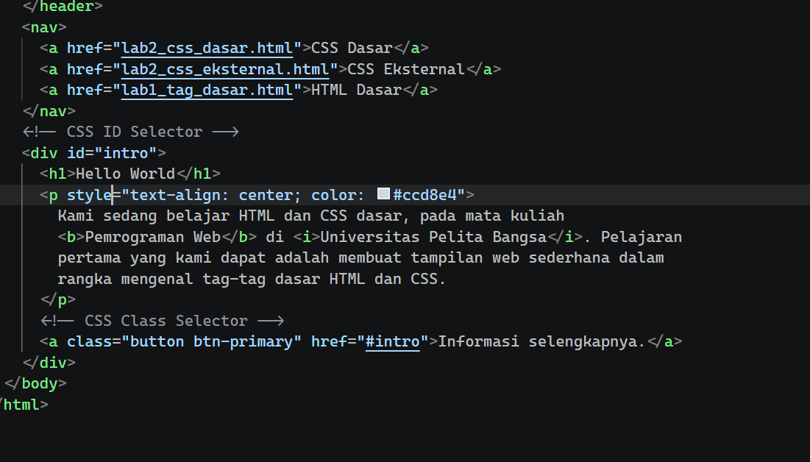
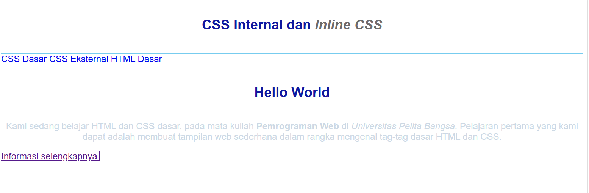
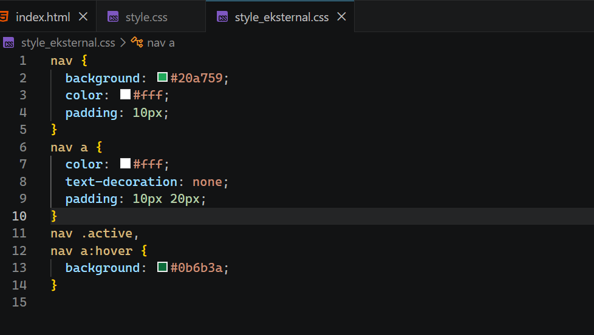
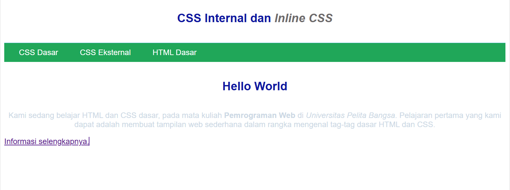
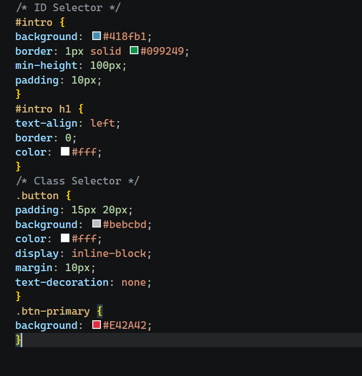
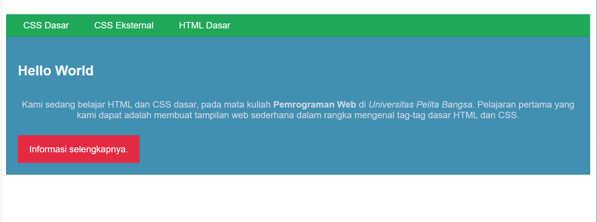

# web4
belajar css

Langkah-langkah Praktikum
1. Membuat dokumen HTML
   
   
2. Mendeklarasikan CSS Internal
menambahkan deklarasi CSS internal seperti berikut pada bagian head dokumen.
    
    
3. Menambahkan Inline CSS
   menambahkan deklarasi inline CSS pada tag 
 seperti berikut.  
    
    
4. Membuat CSS Eksternal
Membuat file baru dengan nama style_eksternal.css
    
    
 5. Menambahkan CSS Selector
Selanjutnya menambahkan CSS Selector menggunakan ID dan Class Selector. Pada file
style_eksternal.css,
    
    
